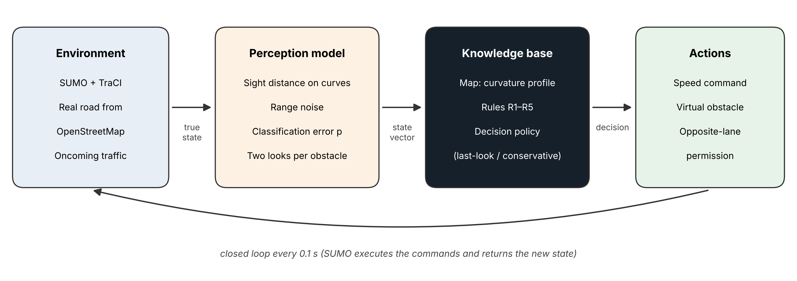

# Knowledge-Driven Intelligent Agent for Edge Case Detection on Curved Roads

Code and data for the paper **"Knowledge-Driven Intelligent Agent for Edge Case Detection and Behavior Planning in Autonomous Vehicles on Curved Roads"**.

The repository contains a knowledge-driven agent that controls an autonomous vehicle in [SUMO](https://eclipse.dev/sumo/) on a real mountain road imported from [OpenStreetMap](https://www.openstreetmap.org): the Mexican Federal Highway 54 between Villanueva and Apozol (Zacatecas). The agent combines map knowledge (the curvature profile of the road), explicit decision rules, and a model of imperfect perception.

<p align="center"></p>

## Main results

810 simulations (3 road segments × 4 classification-error levels × 2 decision policies × 30 seeds, plus a no-agent baseline), 100 km/h cruise speed, 300 veh/h of oncoming traffic:

| Condition | Error *p* | Collision rate with dense obstacles | 95 % Wilson CI |
|---|---|---|---|
| No agent | – | 100.0 % | [97.9, 100.0] |
| Agent, conservative policy | 0 | 0.0 % | [0.0, 2.1] |
| Agent, last-look policy | 0.20 | 32.2 % | [25.8, 39.4] |
| Agent, conservative policy | 0.20 | 16.1 % | [11.5, 22.2] |

With the agent, the lateral acceleration never exceeded 3 m/s² and no collision with oncoming vehicles occurred in any run. See `data/table_summary.csv` for the complete results.

## Repository structure

```
.
├── src/
│   ├── agente_ruta.py      # Agent: map knowledge, rules R1–R5, perception model, simulation loop, metrics
│   ├── ruta_osm.py         # OpenStreetMap download, SUMO conversion, curvature profile, urban exclusion
│   └── ver_tramo.py        # Local visualization of one scenario in sumo-gui
├── notebooks/
│   ├── 01_route_curvature_fed54.ipynb   # Imports the road, computes curvature, selects segments
│   └── 02_final_experiments.ipynb       # Runs the 810 simulations, tables, and figures
├── data/                   # Results and route data (see "Data" below)
├── figures/                # Figures of the paper
├── requirements.txt
├── CITATION.cff
└── LICENSE
```

## Requirements

- Python 3.10 or later
- SUMO **1.27.1** (installed automatically in the notebooks through the `eclipse-sumo` package)
- The packages listed in `requirements.txt`

No GPU is needed. All experiments were run on Google Colab (CPU) and a low-end personal computer.

## Reproducing the results

### Option A — Google Colab (recommended)

1. **Route and curvature.** Open `notebooks/01_route_curvature_fed54.ipynb` in Colab and run all cells. It downloads Federal Highway 54 from OpenStreetMap, converts it to SUMO, computes the curvature profile, excludes urban sections, and selects the three most curved 5-km segments. At the end it downloads `fed54_villanueva_apozol.zip`.
2. **Experiments.** Open `notebooks/02_final_experiments.ipynb` in Colab, upload `fed54_villanueva_apozol.zip` to the file panel, and run all cells (about 45–60 min). The notebook saves a checkpoint after every run, so it can resume if Colab disconnects. It produces `results_final.csv`, the summary tables (CSV and LaTeX), and the figures.

> **Note on exact reproducibility.** OpenStreetMap is continuously edited, so a new download may differ slightly from the one used in the paper. To reproduce the exact numbers, use the original `fed54_villanueva_apozol.zip` provided in `data/` (if available) instead of running notebook 01.

### Option B — Local visualization in sumo-gui

1. Install SUMO 1.27.1 and the requirements: `pip install -r requirements.txt`
2. In notebook 02, section 7, download the scenario package (e.g., `view_S2_seed1_p10_conservadora.zip`) and unzip it.
3. Run `python ver_tramo.py` inside the unzipped folder. The parameters `CON_AGENTE`, `P_ERROR`, `POLITICA`, and `SEMILLA` at the top of the script select the configuration.

## Agent overview

| Rule | Description | Main parameters |
|---|---|---|
| R1 | Curve speed planning: never exceed the speed that allows reaching each upcoming curve at its safe speed √(a_max·R) | a_max = 3 m/s², b_c = 2 m/s², horizon 400 m |
| R2 | Sight-distance rule: S(R) = 2R·arccos(1 − M/R); speed limited to stop within the visible distance | M = 5 m, b_e = 4 m/s², sensor range 200 m |
| R3 | Dense obstacle: project a virtual stationary obstacle at the estimated position (length 3 m + 4σ) | – |
| R4 | Opposite-lane overtaking only if no oncoming vehicle is within the required distance; otherwise wait | ≥ 150 m, 4-s margin, overtaking speed ≤ 8 m/s |
| R5 | Soft obstacle: keep the trajectory | – |

**Perception model:** limited sight distance on curves, range noise σ = 0.03·d + 0.5 m, and classification error *p* (dense ↔ soft), with two looks per obstacle (at first detection and at 50 m). **Policies:** *last-look* (acts on the latest classification) and *conservative* (dense if any look says dense).

### Glossary of identifiers (code in Spanish)

| Spanish | English |
|---|---|
| `agente_decision`, `correr` | agent decision, run simulation |
| `tramo`, `ruta`, `arista` | segment, route, edge |
| `obstaculo denso / blando` | dense / soft obstacle |
| `politica = "conservadora" / "ultima"` | conservative / last-look policy |
| `p_error` | classification error probability |
| `curvas`, `radio`, `perfil_curvatura` | curves, radius, curvature profile |
| `rebasar_contrario`, `esperar_frente_libre` | overtake via opposite lane, wait for a free gap |
| `colision_obst_denso`, `maniobra_innecesaria` | collision with dense obstacle, unnecessary maneuver |
| `t_sobre_umbral_s`, `t_espera_s`, `tiempo_recorrido_s` | time above threshold, waiting time, travel time |

## Data

| File | Description |
|---|---|
| `data/results_final.csv` | One row per simulation run (810 rows): condition, error level, policy, collisions, unnecessary maneuvers, lateral acceleration, waiting and travel times, segment, seed |
| `data/table_summary.csv` | Results by condition, policy, and error level with 95 % Wilson CIs |
| `data/table_per_segment.csv` | Results by segment |
| `data/tramos_elegidos.csv` | The three evaluated segments (km from Villanueva) |
| `data/localities.csv` | Localities used to exclude urban sections, with their distance to the route |

Distances are measured along the route from Villanueva and do not correspond to official kilometer posts.

## Data attribution

Road data © [OpenStreetMap contributors](https://www.openstreetmap.org/copyright), available under the Open Database License (ODbL). Any redistribution of the OpenStreetMap-derived files must keep this attribution and the ODbL terms.

## Citation

If you use this code, please cite the paper (citation details will be added upon publication). See `CITATION.cff`.

## License

The code is released under the MIT License (see `LICENSE`). OpenStreetMap-derived data remain under the ODbL.
